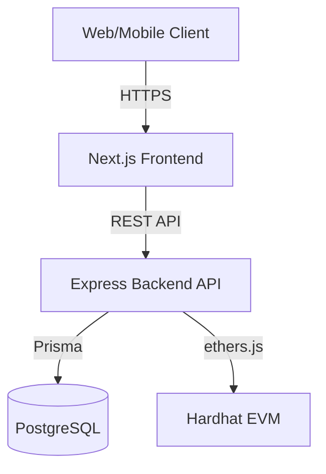
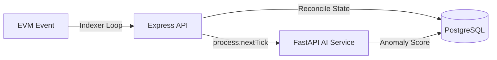

# ReliefChain — Evaluator Demo & Viva Guide

**RELIEFCHAIN — RELEASE CANDIDATE / SUBMISSION READY**

*Live PostgreSQL-backed full-stack E2E remains unverified due to environment infrastructure limitations.*

---

## 1. Deterministic Evaluator Demo Flow (5-Minute Version)

This compact flow traverses the core business logic from disaster creation to public transparency.

| Phase | Actor | Action | Result to Observe |
|---|---|---|---|
| **1. Disaster** | **Authority** | Log in, Create & Activate Disaster. | Disaster state becomes `ACTIVE`. |
| **2. Campaign** | **NGO** | Create Campaign linked to Disaster. **Authority** approves. | Campaign state becomes `ACTIVE`. |
| **3. Donation** | **Donor** | Submit Donation via Web3. | Donation recorded; blockchain TxHash visible; Indexer reconciles to `CONFIRMED`. |
| **4. Allocation** | **NGO** | Propose Allocation. **Authority** signs multisig. | Allocation enters `APPROVED` / `EXECUTING`. Multisig threshold met. |
| **5. Resource** | **Supplier** | Register Resource Batch. | Provenance recorded. Warehouse inventory initializes. |
| **6. Distribution** | **Relief Officer** | Execute Distribution. Upload binary evidence. | `SHA-256` hash generated; mapped to IPFS CID; Inventory decrements; Blockchain `DistributionRecorded` event indexed. |
| **7. Impact** | **Donor** | Open Impact Dashboard. | Proportional attribution shows fractional units tied to specific Distribution. |
| **8. Audit/AI** | **Auditor** | Open AI Alerts & Audit Logs. | AI Anomaly Score visible. Chronological audit log traces user action to blockchain confirmation. |
| **9. Public** | **(Unauthenticated)** | Open Public Dashboard & QR. | Aggregated data visible; PII/passwords strictly masked. |

---

## 2. Technical Demo Flow (10-Minute Version)

For technical evaluation, expand the 5-minute flow to demonstrate internal mechanics:
1. **Frontend Architecture**: Show Next.js Server Components vs. Client hooks.
2. **Database Schema**: Demonstrate the Prisma schema, particularly `MultisigApproval`, `InventoryMovement`, and `AIAlert`.
3. **Smart Contracts**: Walk through `AllocationMultisig.sol` threshold logic and `ResourceProvenance.sol`.
4. **Canonical Event Identity**: Explain how `chainId + transactionHash + logIndex` prevents duplicate replay attacks.
5. **Evidence Hashing**: Demonstrate `crypto.createHash('sha256')` locally mapping to the mocked IPFS CID.
6. **Failure Recovery (AI/Email)**: Show how a simulated failure in the Python FastAPI AI service or SMTP mock does *not* roll back the primary Postgres transaction.

---

## 3. Role-Based Demo Accounts

These accounts are deterministically generated via `npm run seed` with the universal password `devpassword123`.

| Role | Email | Organization | Demo Purpose |
|---|---|---|---|
| **System Admin** | `sysadmin@reliefchain.local` | N/A | Global system management. |
| **Authority** | `authority@gov.local` | Global Disaster Response Agency | Verify Disasters, approve Campaigns, sign Multisig. |
| **NGO Admin** | `ngoadmin@hoperelief.local` | Hope Relief International | Create Campaigns, propose Allocations. |
| **Auditor** | `auditor@trustaudit.local` | Trust Audit Partners | Review Audit Logs and AI Alerts. |
| **Supplier** | `supplier@medlogistics.local` | Global Med Logistics | Register Resource Batches. |
| **Relief Officer** | `reliefofficer@hoperelief.local` | Hope Relief International | Execute Distributions & upload Evidence. |
| **Donor** | `donor@example.local` | N/A | Submit Donations, view Proof-of-Impact. |

---

## 4. Viva Q&A Guide (Evaluator Talking Points)

### Architecture
- **Why Postgres + Blockchain?** Blockchain provides immutable anchoring and transparent trust; Postgres provides relational efficiency, complex queries (like Proof-of-Impact aggregations), and high-speed UX.
- **What is on-chain vs. off-chain?** Financial state transitions and resource provenance anchors are on-chain. Heavy metadata, PII, and evidence files are off-chain.
- **How does the Indexer work?** An asynchronous loop listens for EVM events and reconciles them against `PENDING_CONFIRMATION` Postgres records using the canonical `chainId:txHash:logIndex` identity.

### Security
- **How is RBAC enforced?** `Web2Role` enums are validated via a strict Express middleware (`requireRoles`), returning 403 on violations.
- **Idempotency?** Mutations require an `Idempotency-Key` header, caught natively by Postgres `P2002` unique constraints to resolve concurrent duplicates gracefully (409 Conflict).
- **SQL Injection?** Handled natively by Prisma ORM's parameterized queries, returning safe 4xx/5xx codes instead of leaking payload.

### Blockchain
- **Why EVM/Hardhat?** Industry standard for rapid prototyping, robust testing (`solidity-coverage`), and high compatibility.
- **SYSTEM_INDEXER_ROLE?** A dedicated smart contract role allowing the backend relayer to anchor off-chain distributions asynchronously.
- **Multisig?** Requires M-of-N `SIGNER_ROLE` cryptographic approvals to unlock funds in the Escrow contract.

### AI
- **Why Isolation Forest?** Excellent for identifying multidimensional anomalies (e.g., unusual quantities vs. beneficiary counts) in sparse/unsupervised datasets.
- **Can AI block distributions?** No. AI is strictly *advisory*. It generates alerts for human Auditors, decoupling machine-learning latency/failure from core operational availability.

### Proof-of-Impact
- **What is proportional pooled attribution?** If a Donor provides 10% of a Campaign's funds, they are mathematically attributed 10% of the physical resources distributed by that Campaign.

### Reliability
- **What happens if blockchain reverts?** The Postgres record remains in an `EXECUTING` state and is flagged by the reconciliation loop for manual/automated retry.

---

## 5. Feature -> Evidence Matrix

| Requirement | Feature | Demo Location | Test Evidence | Verification Type | Known Deviation |
|---|---|---|---|---|---|
| **FR-DIS-001** | Disaster Management | `/api/disasters` | `disasters.test.ts` | MOCK VERIFIED | None |
| **FR-FUND-001** | Allocation | `/api/allocations` | `allocations.test.ts` | MOCK VERIFIED | None |
| **FR-MSIG-001** | Multisig | UI / Hardhat | `AllocationMultisig.sol` | EXECUTED (HH) | None |
| **FR-EVID-001** | Evidence Hashing | `/api/distributions` | `distributions.test.ts` | MOCK VERIFIED | Mock IPFS Storage |
| **FR-IMP-001** | Proof-of-Impact | `/api/impact/donor` | `impact.test.ts` | MOCK VERIFIED | Dynamic, not cached |
| **FR-AI-001** | AI Anomaly | `/api/ai/alerts` | FastAPI tests | STATIC VERIFIED | Process-local async |
| **FR-NOT-001** | Notifications | `/api/notifications` | `notifications.test.ts` | MOCK VERIFIED | Mock SMTP provider |

---

## 6. Screenshot & Evidence Checklist

Evaluators should capture these screens:
1. **Login/RBAC**: Demonstrate 403 Forbidden on unauthorized roles.
2. **Disaster Management**: Show `ACTIVE` state transition.
3. **Allocation/Multisig**: Highlight required signatures matching the `Threshold`.
4. **Distribution & Evidence**: Highlight the computed `SHA-256` hash and CID output.
5. **Blockchain Transaction**: Show the Hardhat console output or UI TxHash referencing the anchoring event.
6. **Proof-of-Impact**: Show fractional units linked from Donor to Beneficiary.
7. **AI Alert**: Show Anomaly Score and Reason Code.
8. **Audit Trail**: Highlight chronology: User Action -> DB State -> Indexer Reconcile.
9. **Public Dashboard**: Show aggregate statistics and absence of PII.

---

## 7. Failure Demonstrations (Negative Paths)

Demonstrate these safe failures during the Viva:
- **Unauthorized Role**: Use Donor token to attempt Disaster creation -> **403 Forbidden**.
- **Duplicate Idempotency**: Send identical `POST /api/distributions` twice -> First succeeds, second returns **409 Conflict** (no duplicate chain transaction).
- **Invalid QR**: Query `/api/qr/verify/fake-id` -> **404 Not Found** (Does not crash server).
- **Insufficient Inventory**: Distribute 99,999 units -> **400 Bad Request** (Inventory invariant maintained).

---

## 8. Architecture Diagrams (Mermaid)

### System Architecture

### Async Indexer & AI Flow

---

## 9. Viva One-Liners

- **Blockchain**: Immutable anchoring layer for funds and provenance to guarantee public trust.
- **Indexer**: An asynchronous polling service that watches EVM events and updates Postgres state deterministically using `chainId:txHash:logIndex`.
- **Multisig**: Smart contract logic requiring M-of-N cryptographic signatures to execute critical financial allocations.
- **SHA-256 / IPFS**: Cryptographically tying off-chain binary evidence to an immutable on-chain record via content addressing.
- **Idempotency**: Guaranteeing that retried HTTP requests (e.g., due to network drops) never result in duplicate financial or inventory transactions.
- **Proof-of-Impact**: Bridging the gap between a financial donation and a physical distribution using proportional math.
- **Isolation Forest**: An unsupervised machine learning algorithm optimized for detecting outliers in multidimensional supply-chain data.
