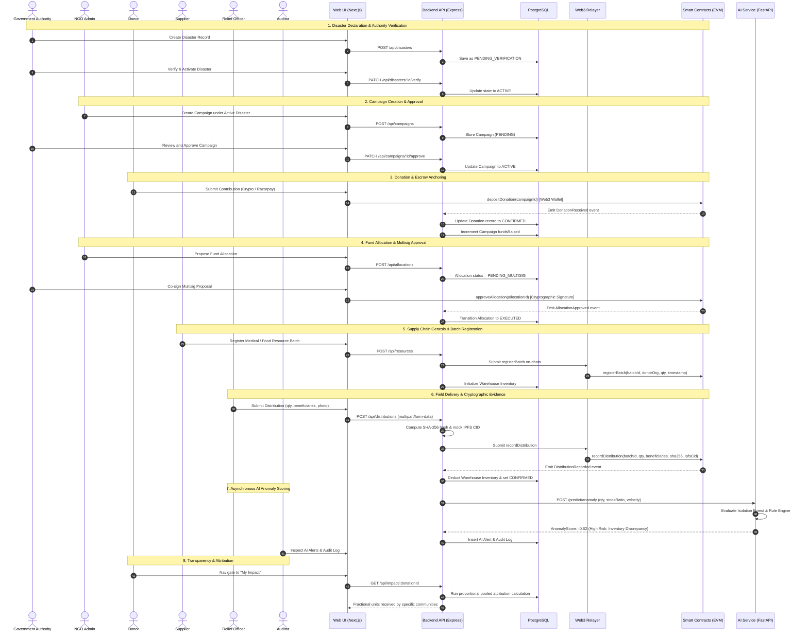
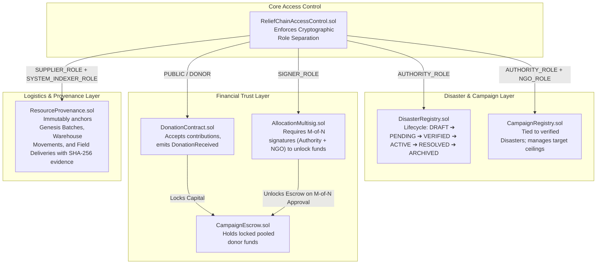

# ReliefChain: System Architecture Specification

ReliefChain implements a **hybrid Web2/Web3 architecture** engineered for humanitarian logistics. It combines high-throughput relational data operations in PostgreSQL with tamper-evident, decentralized smart contract settlement on an EVM blockchain, assisted by an asynchronous Machine Learning anomaly detection microservice.

---

## 1. High-Level Multi-Tier Architecture Diagram

```mermaid
graph TB
    subgraph "Client Layer (Presentation)"
        UA["Government Authority"]
        UN["NGO Admin / Operator"]
        UD["Donor (Crypto / Fiat)"]
        US["Medical / Food Supplier"]
        UW["Warehouse Operator"]
        UO["Field Relief Officer"]
        UR["Auditor / Regulators"]
        UP["Public Citizen"]
    end

    subgraph "Frontend Web Application (apps/web - Next.js 14)"
        FE["Next.js App Router (Port 3000)"]
        UI_AUTH["Role-Based Dashboards"]
        UI_WALLET["Web3 Provider & Wallet Adapter"]
        UI_PUBLIC["Public Transparency Dashboard & QR Scanner"]
        FE --> UI_AUTH
        FE --> UI_WALLET
        FE --> UI_PUBLIC
    end

    UA & UN & UD & US & UW & UO & UR & UP --> FE

    subgraph "Core Backend Services (apps/api - Express / TypeScript)"
        API_GW["Express API Server (Port 3002)"]
        MIDDLEWARE["Middleware: JWT Auth, RBAC, Rate Limiter"]
        
        subgraph "API Modules"
            MOD_DIS["Disasters & Campaigns"]
            MOD_DON["Donations & Escrow"]
            MOD_ALLOC["Allocations & Multisig"]
            MOD_PROV["Resource Provenance & Batches"]
            MOD_INV["Warehouse Inventory"]
            MOD_DIST["Field Distribution & QR"]
            MOD_IMP["Proof-of-Impact Attribution"]
        end

        subgraph "Blockchain Integration Engine"
            RELAYER["Web3 Relayer (SYSTEM_INDEXER_ROLE)"]
            INDEXER["Event Indexer & Poller"]
            RECON["Reconciliation & Retry Engine"]
        end

        API_GW --> MIDDLEWARE
        MIDDLEWARE --> MOD_DIS & MOD_DON & MOD_ALLOC & MOD_PROV & MOD_INV & MOD_DIST & MOD_IMP
        MOD_DIST & MOD_DON & MOD_ALLOC --> RELAYER
        INDEXER --> RECON
    end

    FE -->|"/api/* Proxy / HTTP Requests"| API_GW
    UI_WALLET -->|"Direct RPC / Client Signatures"| HARDHAT

    subgraph "Data & Storage Layer"
        PG[("PostgreSQL 15 (Prisma ORM)
Operational State of Truth")]
        REDIS[("Redis 7 (Port 6379)
Cache, Locks & Queue")]
        FS_STORAGE[("Off-Chain Storage / Mock IPFS
SHA-256 Hashes & Binary Proofs")]
    end

    MOD_DIS & MOD_DON & MOD_ALLOC & MOD_PROV & MOD_INV & MOD_DIST & MOD_IMP <--> PG
    API_GW <--> REDIS
    MOD_DIST <--> FS_STORAGE
    RECON <--> PG

    subgraph "Trust Layer (Web3 - EVM Smart Contracts)"
        HARDHAT["EVM Node / Hardhat Network (Port 8545)"]
        
        AC["ReliefChainAccessControl
(RBAC on-chain)"]
        DR["DisasterRegistry"]
        CR["CampaignRegistry"]
        DC["DonationContract"]
        CE["CampaignEscrow"]
        AM["AllocationMultisig
(M-of-N Signatures)"]
        RP["ResourceProvenance
(Batch & Distribution Anchoring)"]

        HARDHAT --> AC
        AC --> DR & CR & DC & CE & AM & RP
    end

    RELAYER -->|"Gas-Subsidized Tx Submission"| HARDHAT
    INDEXER -->|"Cursor Polling (eth_getLogs)"| HARDHAT
    RECON -->|"Confirmed Block Sync"| PG

    subgraph "AI & Risk Analytics (apps/ai-service - FastAPI)"
        AI_SRV["FastAPI Service (Port 8000)"]
        IF_MODEL["Isolation Forest ML Model"]
        RULE_ENG["Deterministic Rule Engine"]
        
        AI_SRV --> IF_MODEL
        AI_SRV --> RULE_ENG
    end

    MOD_DIST -->|"Async HTTP Trigger (/predict/anomaly)"| AI_SRV
    AI_SRV -->|"Anomaly Score & Reason Codes"| MOD_DIST
```

---

## 2. End-to-End Disaster Response Lifecycle

---

## 3. Smart Contract Architecture & Role Access Matrix

---

## 4. On-Chain vs. Off-Chain Data Boundary

| Component / Entity | Off-Chain (PostgreSQL + Prisma) | On-Chain (EVM Smart Contracts) | Storage Abstraction (SHA-256 / IPFS) |
| :--- | :--- | :--- | :--- |
| **User & Organization Identity** | Passwords (bcrypt), emails, JWT sessions, profiles, Web2 RBAC | Ethereum Public Wallet Addresses (`address`) | N/A |
| **Disasters** | Detailed rich descriptions, emergency contact data, full geography | `bytes32` identifier, verification status, declaration timestamp | N/A |
| **Campaigns** | Title, narrative, images, operational milestones | `bytes32` campaignId, target ceiling, status | N/A |
| **Donations** | Payment IDs (Razorpay), donor user IDs, fiat currency rates | `uint256` token amount, campaign escrow mapping, transaction hash | N/A |
| **Allocations** | Itemized purchase orders, vendor invoices, quote PDFs | `allocationId`, multisig approval bitmap, execution state | Invoice PDFs hashed to SHA-256 |
| **Resource Batches** | SKU numbers, manufacturer details, expiry dates, temperature logs | `bytes32` batchId, supplier address, batch quantity ceiling | Manufacturer quality certificates |
| **Warehouse Inventory** | Stock counts, warehouse location bins, shelf allocations | Deducted atomically during distribution | N/A |
| **Field Distributions** | Officer identity, recipient community names, notes | Beneficiary counts, quantity, relayer signature | Binary photos hashed to SHA-256 + IPFS CID |
| **AI Anomaly Alerts** | Anomaly scores, rule violation codes, auditor review logs | Unaltered (AI is purely advisory; no on-chain blocking) | N/A |

---

## 5. Security & Reliability Highlights

1. **Gas Abstraction & Relayer**: Field relief officers and suppliers do not need local gas tokens. The backend `Web3Relayer` submits transactions on their behalf using `SYSTEM_INDEXER_ROLE`.
2. **Idempotency & Replay Protection**: Blockchain event ingestion uses canonical identities (`chainId : txHash : logIndex`) and stores processed block cursors in PostgreSQL to prevent duplicate processing during node restarts.
3. **Decentralized Escrow Separation**: NGOs cannot directly withdraw donated capital. Funds can only be unlocked from `CampaignEscrow` through `AllocationMultisig` co-signed by an accredited Government Authority.
4. **Advisory AI Design**: Anomaly detection runs asynchronously using an Isolation Forest model to avoid latency on emergency logistics while guaranteeing an immutable human-auditable trail.
